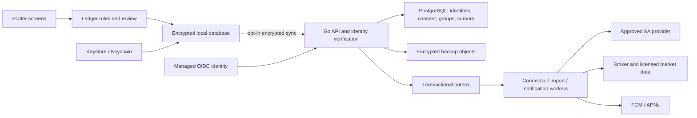

# Architecture decision: private mobile ledger, selective connected services

Decision recorded 2026-10-10. India first; Flutter Android/iOS; target one million registered users, subject to measured workload and load testing. This document supersedes the older `ARCHITECTURE.md` assumptions about mandatory day-one microservices and a web-first, centrally stored ledger. The old scaffold is retained, not deployed.

## 1. Local-only storage versus connected features

| Option | Benefits | Tradeoffs |
|---|---|---|
| Device-only encrypted database | Offline speed; personal ledger stays on the phone | Lost-device recovery is impossible without a backup; no independent background connector or group delivery |
| Device-first + end-to-end encrypted backup | Offline operation with recovery/multiple devices; storage service cannot read backup payloads | Key recovery, rotation, conflict resolution and metadata remain your responsibility |
| Device-first + selected cloud services **(recommended)** | Personal ledger private by default; opt-in banking, broker access and collaboration | Connector servers process bank data; shared records require an explicit visibility policy |
| Conventional managed backend (for example PostgreSQL/Supabase or Firebase) | Quicker central querying, sharing and operations | User financial data exists on your infrastructure; access controls and encryption at rest are not end-to-end encryption |
| User-owned Drive/iCloud encrypted files | Users choose the backup account and retain file control | OAuth permissions, platform differences, quota and conflict management; unsuitable as the authoritative group ledger |

The implementation currently covers the first option without recovery. Optional backup and connected services are a proposed design. **No current cloud encryption or bank connection is implied.**

Solid mobile UI → local-database flow is implemented. The connected architecture is planned.

## 2. Data boundaries

Personal transaction amounts, items, notes, holdings and local participant labels remain in the vault unless the user opts into a named feature. Server authentication needs identity metadata, not the whole ledger. Separate identity deletion, connector revocation, shared-record retention and local-vault deletion in both implementation and UI.

Use a random per-vault encryption key, platform secure storage and device authentication. A provider token is not a database key. An online password reset must not silently regenerate the vault key and overwrite data. Recovery requires a deliberate user-held recovery secret or another trusted device; losing all keys means the server cannot decrypt a truly end-to-end encrypted vault.

An encrypted-backup server can validate envelope versions, sizes, ownership and revisions. It **cannot** validate the financial contents of ciphertext. Keep personal ledger rules on the device. For server-readable shared records, document exactly which members/server components can see each field; use authoritative validation and group membership checks. If groups later use end-to-end encryption, design member-key distribution and validation separately.

Bank connectors usually receive financial data on a server before forwarding/encrypting it for the user. Such a pipeline is not zero-knowledge ingestion. Minimise and document temporary retention, encrypt provider tokens with KMS, redact logs and delete transient imports after their retention window. A consent revocation cancels queued/future fetches and follows the provider's deletion/retention contract.

## 3. Backend: start with clear modules

Keep Go, already introduced in this repository. Start with an API process and a worker process from a **modular monolith**: identity integration, consent/connectors, sync, shared ledger, imports, notifications, portfolio and reporting. Managed PostgreSQL is the durable coordination store. Use an object store for encrypted documents/backups and a managed queue or database outbox for slow work. Redis is optional for demonstrated cache/rate-limit needs.

A million registered users does not require a separate deployment for every module. Extract a service when it has independent ownership, a different security boundary, or a measured bottleneck. Bank/document workers and market-data fan-out are likely early candidates. Kafka, CockroachDB and Kubernetes remain options after measurements justify their operating cost.

Do not expose the existing Go auth prototype as production identity: it currently uses an in-memory user repository; logout does not revoke tokens; refresh rotation/replay prevention and OIDC endpoints are unfinished. The existing web Clerk integration can continue while a supported native identity flow is added. Validate JWT signature/algorithm, issuer, audience, expiry and session revocation as appropriate; derive user identity from verified claims, never a request body.

## 4. Money and accounting

- INR amounts are integer paise, not binary floating point. The mobile bound is ±9,000,000,000,000 paise, deliberately within JavaScript's exact-integer range. Money formatting alone uses decimal display.
- An expense has independent item/category allocation and person allocation; each must sum exactly to the bill. The current UI does not allocate individual items to individual people.
- ₹100 split three ways is ₹33.34 + ₹33.33 + ₹33.33. Remainders are assigned deterministically.
- If you pay ₹1,200 and your own share is ₹400, your bank falls by ₹1,200, your spending rises ₹400, and receivables rise ₹800. Your net worth falls ₹400.
- If a friend pays that bill, your bank is unchanged and your payable rises by your ₹400 share. The app does not claim to manage obligations between other people.
- Borrowing/lending and principal repayments change assets/liabilities, not income/expenses. Interest and fees need explicit expense/income components in a later loan model.
- Own-account transfers have two balanced legs. Portfolio purchases are also asset movements, not consumption; the current manual holding snapshots do not move bank funds automatically.

Before connected posting, introduce a balanced journal with assets/liabilities/income/expense accounts and reversal entries. Use ACID transactions for entry, postings, projections, idempotency result and outbox insert. Check balanced totals per currency; represent FX with explicit conversion legs and rates. Do not silently use last-write-wins for posted financial amounts. The current local CRUD implementation revalidates subsequent repayment obligations when editing/deleting.

## 5. Sync, imports and collaboration contracts

Suggested routes (not implemented endpoints):

| Route | Contract |
|---|---|
| `POST /v1/devices` | Verified identity; register a device public key with proof/verification policy |
| `POST /v1/vault/changes` | `operationId`, `deviceId`, `baseRevision`, encrypted envelope, schema version; unique `(userId, operationId)` |
| `GET /v1/vault/changes?cursor=...` | Stable, opaque server cursor; bounded pages; tombstones included |
| `POST /v1/groups/{id}/expenses` | Membership checked; amount/items/shares validated; idempotent atomic posting |
| `POST /v1/groups/{id}/settlements` | Proposal/acceptance state; user-reported repayment is not evidence of bank transfer |
| `POST /v1/consents` | Purpose, scope, accounts, frequency, retention and expiry; provider consent session |
| `DELETE /v1/consents/{id}` | Revoke future access, cancel outstanding work and track provider acknowledgement |
| `POST /v1/imports` | Explicit processing mode/consent, bounded MIME/size; return asynchronous job ID |
| `POST /v1/imports/{id}/confirm` | Validated reviewed draft IDs and account; exact-once effect via idempotency |
| `DELETE /v1/me` | Start account deletion; revoke tokens, backups, devices and consent under retention policy |

Write local mutations and a sync-outbox record in one local database transaction once sync is introduced. Retry with the **same** operation ID and exponential backoff plus jitter. A newer server revision returns a conflict for user reconciliation; client wall clocks do not order authoritative events. Do not mark a local change synced until acknowledged. A crash after server commit but before client acknowledgement must not duplicate the transaction.

An import row has source/provider identity and a stable external transaction ID where available. The current CSV importer uses account+reference, or exact-file hash+row as a fallback. It flags same-account/date/type/amount matches for review rather than deleting legitimate duplicate purchases. Pending versus settled bank records, bank reversals, overlapping files, edited references and different encodings need provider-aware reconciliation. CSV selection commits atomically or adds no rows.

For groups, an invitation does not establish someone else's agreement to a debt. Distinguish proposed, accepted, disputed and settled records. Invitees who do not use the app receive a user-authorised link/message containing the minimum necessary information. Push payloads should be generic by default. Rate-limit reminders, respect quiet hours and allow opt-out.

## 6. India integrations and financial guidance

India's Account Aggregator ecosystem is consent-driven. FIU participation is restricted to eligible regulated entities; a technology provider/API purchase alone does not grant eligibility. Confirm the business/legal arrangement and each bank's coverage before selecting an integration. Direct bank partnerships and manual statement imports are alternatives. Do not collect net-banking passwords, OTPs or screen-scrape authenticated banking pages. [Sahamati FAQ](https://sahamati.org.in/faq/).

Broker APIs differ. Kite documents portfolio holdings and authenticated market-data streaming, but API capability does not confer a licence to redistribute quotations to a million users. Confirm commercial terms, quotas, session expiry and exchanges covered; show quote timestamps and stale status. [Kite portfolio documentation](https://kite.trade/docs/connect/v3/portfolio/), [streaming documentation](https://kite.trade/docs/connect/v3/websocket/).

Start with descriptive portfolio analytics and financial education. Personalised security selection, allocation and product recommendations need suitability and a compliant advisory model. [SEBI investor explanation](https://investor.sebi.gov.in/investment_advisor.html). Map actual personal-data processing and applicable commencement dates against the notified rules before public launch. [MeitY DPDP rules](https://www.meity.gov.in/documents/act-and-policies/digital-personal-dataprotection-rules-2025gDOxUjMtQWa?pageTitle=Digital-Personal-Data-ProtectionRules-2025). These are release design dependencies, not a claim of certification or legal clearance.

## 7. Migration and release

Keep web data unchanged until an authenticated export/import and reconciliation flow exists. Parse legacy decimal amounts exactly from strings, preserve original record IDs and source IDs, and map Clerk subjects to native identities. Do not bulk-copy production records into a new model or silently switch the web app to the experimental Go service.

The mobile repository persists changed objects in one SQLCipher transaction, but currently loads the full local history for projections. Before large-ledger release, use normalised posting tables, indexed date/account queries, paginated activity and SQL aggregates. Test 100k+ records on a representative low-memory Android phone; server scale does not fix a slow local UI.

Store release requires native integration testing, signed builds, privacy policy/support URLs, data disclosures, permission minimisation, recovery and deletion testing. Apple requires an in-app account-deletion initiation flow for apps that create accounts; Play requires financial-features declarations. Review the app's actual scope against current store policies at submission. [Apple account deletion](https://developer.apple.com/support/offering-account-deletion-in-your-app/), [Google Play financial declaration](https://support.google.com/googleplay/android-developer/answer/13849271), [Google Play user data](https://support.google.com/googleplay/android-developer/answer/10144311).

Additional implementation references: [Flutter offline-first architecture](https://docs.flutter.dev/app-architecture/design-patterns/offline-first), [SQL persistence](https://docs.flutter.dev/app-architecture/design-patterns/sql), [SQLCipher Flutter adapter](https://pub.dev/packages/sqflite_sqlcipher), [device authentication](https://pub.dev/packages/local_auth). Dependencies are locked in the mobile lockfile; native security properties still need device tests.
